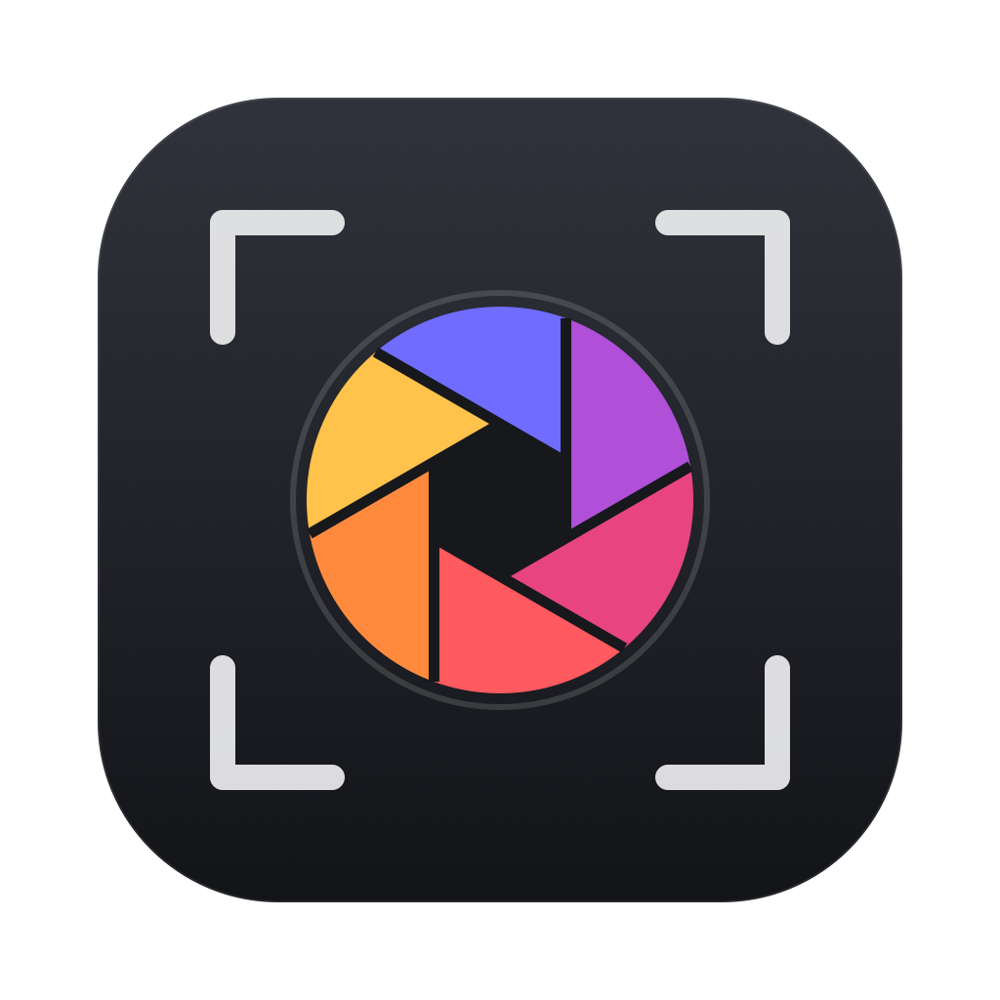

<p align="center"></p>

<h1 align="center">Кадр</h1>

<p align="center">Быстрый отбор RAW-фотографий для macOS — просмотр, оценки, серии и дубли.</p>

<p align="center"><a href="README.md">English</a> · <b>Русский</b> · <a href="https://github.com/araoijj/kadr/releases/latest">Скачать</a></p>

---

«Кадр» — лёгкое нативное приложение для первого этапа работы со съёмкой: быстро пролистать сотни RAW, отобрать лучшие и отдать их в обработку. Оценки сохраняются в стандартные XMP-файлы, поэтому их сразу видят Capture One, Lightroom и другие редакторы.

## Возможности

- **Мгновенный и резкий просмотр RAW.** Сразу — JPEG-превью камеры (~20 мс), через ~0,6 с — RAW, проявленный под разрешение экрана с цветами камеры (следующий кадр готовится заранее): встроенное превью часто всего 1616 px и на Retina выглядит мутным.
- **Режим «Отбор» (O):** прогресс просмотра, счётчики «оставлено / брак / без решения», очереди «Без решения», «Возможный брак», «Быстрый проход» (лидеры серий и одиночные кадры), лица в 100% сбоку, итог с действиями. «Подсказки» выключаются — тогда отбор полностью ручной. Можно открывать папки сразу в этом режиме.
- **Турнир (T):** кадры серии или выделенные — парами, ← или → выбирает лучший, победитель остаётся; в конце — ★ победителю и, по желанию, брак остальным.
- **Сцены:** съёмка сама делится по паузам (по умолчанию 10 минут) — группировка «По сценам» и раздел «Сцены» с прогрессом отбора.
- **AI-отбор — по кнопке.** При открытии папки идёт только лёгкая индексация (EXIF, серии, дубли; ~15 мс на кадр). Тяжёлый AI-анализ запускается кнопкой «Запустить AI-анализ» (⌥⌘A) в режиме «Отбор», с прогрессом и «Стоп», — или сам, если включить в настройках.
- **Поиск брака офлайн (встроенный анализ macOS):** нерезкий кадр (по лицу или главному объекту), моргание и закрытые глаза (сетка лица MediaPipe: отличает моргание от прищура, смеха и взгляда вниз), пересвет, недосвет, служебные кадры, дубли, «слабее в серии»; завал горизонта — как поправимое, кнопка «Выровнять». Ползунок строгости, оценка кадра 0–100. Лучший в серии — по резкости лица, открытым глазам, качеству лица, эстетике и экспозиции. Массовые действия — с подтверждением и отменой через журнал.
- **Отбор с клавиатуры.** Звёзды 1–5, отклонение, цветные метки, автопереход к следующему кадру.
- **XMP-сайдкары.** Совместимы с Capture One / Lightroom / Bridge / darktable; посторонние поля в существующих XMP не затираются.
- **Серии и дубли.** Похожие кадры подряд (серийная съёмка, брекетинг) группируются, в каждой серии отмечается самый резкий. Находятся точные копии файлов.
- **Работа с набором.** ⌘/⇧-клик, ⇧-стрелки, ⌘A, выделение рамкой мышью; оценки и метки применяются ко всем выделенным.
- **Сохранение в папку.** Оригиналы RAW+XMP (копия или перенос) или JPEG с выбором размера и качества; клавиша S отправляет кадр в папку сразу.
- **Зум до 800%** с навигатором: при увеличении проявляется только видимый кусок RAW в полном разрешении — с текущей обработкой, ползунки работают прямо в 100%.
- **AI-кадрирование по предложению:** оставленным или выделенным кадрам по очереди предлагается рамка — фигуры людей не режутся, лица ставятся по третям, небольшой завал горизонта выравнивается; Enter — принять (можно сначала поправить), Esc — пропустить. В редакторе кадрирования — кнопка «Авто» (A).
- **Кадрирование и горизонт** (R): форматы 4:5 пост Instagram, 1:1, 9:16 сторис/Reels, 1.91:1, 3:2, 4:3, 16:9 и свободный; рамка с сеткой третей, выравнивание горизонта без пустых углов, одно кадрирование на всю выделенную серию.
- **Пресеты экспорта для соцсетей без двойной настройки:** «Instagram лента» берёт формат из вашего кадрирования (4:5 → 1080×1350, 1:1 → 1080×1080, 1.91:1 → 1080×566; некадрированные — как есть, если формат подходит Instagram, иначе по центру до 4:5/1.91:1), «Сторис/Reels» 1080×1920, «Сайт/Telegram» 2560 px. Окно заранее показывает, во что превратится каждый кадр.
- **Быстрая обработка в единицах Lightroom:** экспозиция ±5 EV, температура в кельвинах от «как снято» из RAW, оттенок ±150, остальное ±100; кнопка «Исходник» возвращает кадр как снято. Ползунки: экспозиция, контраст, света, тени, матовость, температура, оттенок, красочность, насыщенность — вживую на RAW (~25 мс на движение ползунка). Сравнение «до/после».
- **Профиль «Как в камере».** Для каждого RAW «Кадр» подбирает цветовое соответствие с JPEG камеры (и её кадрированием, например 4:3), поэтому обработка начинается с привычных цветов, а открытие панели «Обработка» ничего не меняет. Стандартный профиль macOS — на выбор.
- **Рецепты по коллекциям.** ~36 готовых стилей: «Базовые», «Портрет», «Пейзаж», «Кино», «Чёрно-белые», «Плёнка» (Portra, Ektar, Gold, Fuji 400H, Velvia, Kodachrome, Tri-X, HP5…), с превью на текущем кадре; свои стили — в «Мои стили». Инструменты: чёткость, тонирование теней и светов, виньетка, зерно.
- **LUT.** `.cube` и HaldCLUT `.png` с регулировкой силы; бесплатная коллекция плёнки скачивается прямо из приложения. Стиль применяется сразу ко всем выделенным.
- **Копировать / вставить обработку** с кадра на кадр или на весь набор.
- **JPEG с обработкой**, водяным знаком и переименованием по шаблону (`{folder}_{date}_{n}`).
- **Папки и диски.** Боковая панель: избранное, недавние, подключённые диски и карты памяти (появляются сами), дерево вложенных папок со счётчиком снимков; режим «с вложенными папками».
- **Сортировка и группировка.** По времени съёмки, имени, оценке, объективу, папке, размеру; группы по дням, папкам, объективам, оценке. Фильтры по объективу и дате сочетаются с фильтром по оценке.
- **Импорт с карты памяти.** При подключении карты появляется предложение импортировать; раскладка по дням съёмки («2026-10-20 Свадьба»), пропуск уже импортированного, сверка размера каждой копии, извлечение карты после импорта.
- **Сравнение любого числа кадров** (до 200) рядом с общим зумом и сдвигом: видно одно и то же место на всех кадрах; «оставить выбранный, остальные отклонить».
- **Индекс анализа.** Резкость, серии, EXIF сохраняются в `~/Library/Application Support/Kadr/Index`; при повторном открытии папки пересчитываются только новые и изменённые файлы, фоном в 2 потока с низким приоритетом.
- **Шторка «до / после»** (Y): линия на кадре, слева без цвета и тона, справа с обработкой; рамка и горизонт общие, работает и при увеличении.
- **Журнал изменений и отмена:** ⌘Z / ⇧⌘Z и стрелки в панели; вкладка «Журнал» — каждый шаг (ползунки, стили, кадрирование, оценки, метки) с временем и кадрами, клик — перейти к состоянию; движения одного ползунка склеиваются в шаг; до 100 шагов на папку, журнал сохраняется между запусками.
- **Языки:** русский, English, Español, Italiano — выбор в настройках (или как в системе).
- **Настройки (⌘,):** язык; открывать последнюю папку; папка данных и что сколько занимает (индекс, журналы, LUT, стили) с очисткой; потоки анализа, кэши в памяти и текущее потребление памяти; размер журнала; импорт по умолчанию; стили и LUT; резервная копия .zip (стили, LUT, настройки, журналы) и восстановление.
- **Без удаления.** Отклонённые переносятся в подпапку «_Отклонённые».

Поддерживаются RAW Sony, Canon, Nikon, Fujifilm, Olympus, Panasonic, Pentax, DNG, а также JPEG, HEIC, PNG, TIFF — всё, что читает macOS.

## Горячие клавиши

Та же таблица, что в приложении: **Справка → Горячие клавиши** (⌘/ или ?).

**Отбор**

| Клавиша | Действие |
|---|---|
| P / X / U | оставить (★, если нет оценки) / брак / снять решение |
| ⌫ | брак / вернуть из брака |
| 1–5 / 0 | звёзды / снять оценку |
| 6–9 | цветная метка: красный, жёлтый, зелёный, синий |
| H | скрыть / показать брак |
| O | слой «Отбор»: ярлыки AI, лица, прогресс |
| T | турнир: ← / → — лучший кадр |
| C | сравнить выделенные (или кадры серии) |
| P, Пробел / X | в сравнении: отметить «оставить» / «брак» |
| Enter | в сравнении: применить отметки |
| Z / + / − | в сравнении: зум / размер кадров |
| C / Esc | выйти из сравнения |
| ⌥⌘A | запустить AI-анализ |
| ⌘⌫ | перенести брак в «_Отклонённые» |
| ⌥⌘F | сбросить все фильтры |

**Просмотр**

| Клавиша | Действие |
|---|---|
| ← → ↑ ↓ | листать; с ⇧ — расширить выделение |
| ⌘ / ⇧ + клик | выделить несколько |
| ⌘A / ⇧⌘A | выделить всё / серию |
| Пробел / Enter | сетка ↔ кадр |
| G | к сетке |
| Esc | назад: из 100%, из серии, к сетке; снять выделение |
| Z / двойной клик | 100% в точку клика / вписать |
| ⌘+ / ⌘− / ⌘0 / ⌘1 | увеличить / уменьшить / вписать / 100% |
| + / − | увеличить / уменьшить без ⌘ |
| щипок, ⌘ + колёсико | плавный масштаб; прокрутка и перетаскивание — сдвиг |
| F | во весь экран; F или Esc — выйти |
| I | панель «Инфо» |
| ⌥⌘1 / ⌥⌘2 | панель: источники / фильтры |

**Обработка**

| Клавиша | Действие |
|---|---|
| E | панель «Обработка» |
| R | кадрирование; Enter — готово, Esc — отмена |
| A | в кадрировании — AI-предложение рамки |
| Enter / Esc | «Убрать объект»: убрать выделенное / снять выделение, выйти |
| Y | шторка «до / после» (тянуть линию) |
| \\ | показать исходник |
| ⇧⌘C / ⇧⌘V | копировать / вставить обработку |
| ⌥⌘R | сбросить обработку |
| ⌥⌘M | выровнять экспозицию и баланс по текущему |
| ⌘Z / ⇧⌘Z / ⌘Y | отменить / вернуть / журнал изменений |

**Файлы**

| Клавиша | Действие |
|---|---|
| S | отправить в папку сохранения |
| ⌘S | сохранить в папку… |
| ⌘O | открыть папку… |
| ⌘I | импорт с карты памяти |
| ⇧⌘O | открыть в Capture One |
| ⇧⌘R | показать в Finder |
| ? / ⌘/ | эта шпаргалка |
| правый клик | меню действий над кадром или выделением |

Русская раскладка тоже работает: З / Ч / Г вместо P / X / U.

Обработка хранится в скрытой папке `.kadr/edits.json` внутри съёмки — оригиналы и XMP не меняются. Свои стили и LUT лежат в `~/Library/Application Support/Kadr/`.

## Перевод интерфейса

Строки интерфейса проходят через `tr()` (Sources/Kadr/I18n.swift): точное совпадение или шаблон с `{}` на месте подстановок. Переводы — `tools/i18n/all.json` (русский → en, es, it). Новая строка: `python3 tools/i18n.py wrap && python3 tools/i18n.py extract`, добавить перевод в all.json, `python3 tools/i18n.py build`.

## Установка

Готовое приложение — в [выпусках](https://github.com/araoijj/kadr/releases/latest): нужен Mac на Apple Silicon и macOS 15 Sequoia или новее (переключатель «Восстановление светов» для RAW — macOS 26+). Для macOS 14 Sonoma — версия [1.4.10](https://github.com/araoijj/kadr/releases/tag/v1.4.10), последняя для неё. Проверено на macOS 26 Tahoe и macOS 27 (Apple M2); на macOS 15 приложение собирается, но ещё не проверялось — будем рады отзывам. На macOS 27 нужна версия 1.4.9 / 1.5.0 бета 10 или новее: старые там закрываются сразу после запуска. Распакуйте и перенесите «Кадр» в «Программы». Приложение не нотаризовано Apple, поэтому при первом запуске: правый клик → «Открыть» → «Открыть» (или `xattr -dr com.apple.quarantine /Applications/Kadr.app`).

## Сборка

Нужны macOS 15+ и Command Line Tools (Xcode не требуется; с Command Line Tools 27 `build.sh` собирает против SDK macOS 26, который идёт в комплекте):

```sh
xcode-select --install   # если ещё не установлены
./build.sh               # тесты, затем → build/Kadr.app и ~/Applications/Kadr.app
./build.sh test          # только тесты
```

`build.sh` сначала запускает тесты импорта с карты, XMP и экспорта (`Tests/KadrTests`, Swift Testing — входит в Command Line Tools); если хоть один не прошёл, ничего не собирается и не ставится.

Иконка рисуется кодом: `swift tools/make-icon.swift Resources/AppIcon-1024.png`.

## Устройство

| Файл | Что внутри |
|---|---|
| `ImageStore.swift` | чтение превью и EXIF (ImageIO), проявление RAW (CIRAWFilter), dHash и оценка резкости |
| `Library.swift` | модель: папка, фильтры, выделение, оценки, серии, файловые операции |
| `Sidecar.swift` | чтение и запись XMP |
| `Edit.swift` | настройки обработки, стили, LUT, конвейер фильтров Core Image |
| `Renderer.swift` | отрисовка с кэшем проявленного RAW |
| `Exporter.swift` | сохранение в папку: оригиналы или JPEG, водяной знак, шаблон имени |
| `*View.swift`, `Sidebar.swift`, `InfoPanel.swift` | интерфейс на SwiftUI |

## Благодарности

Эмуляции плёнки — [t3mujinpack](https://github.com/t3mujin/t3mujinpack) © João Almeida, лицензия MIT. Файлы не входят в репозиторий: «Кадр» скачивает их с GitHub по кнопке и кладёт рядом лицензию автора.

Сетка лица для поиска моргания — [MediaPipe Face Landmarker](https://ai.google.dev/edge/mediapipe/solutions/vision/face_landmarker) © Google, лицензия Apache 2.0. Модели перегнаны в Core ML (~7 МБ, ~12 мс на лицо на нейроядре) и встроены в приложение вместе с лицензией и NOTICE; в репозитории их нет — `build.sh` берёт архив из выпуска [models-1](https://github.com/araoijj/kadr/releases/tag/models-1).

Дополнительные пакеты моделей (выпуск [models-2](https://github.com/araoijj/kadr/releases/tag/models-2), ставятся в «Настройки → AI»): [SFace](https://github.com/opencv/opencv_zoo/tree/main/models/face_recognition_sface) (OpenCV Zoo), [SCUNet](https://github.com/cszn/SCUNet) (Kai Zhang и соавторы), [SAM 2.1 Small](https://huggingface.co/apple/coreml-sam2.1-small) (Meta, Core ML от Apple) и [LaMa](https://huggingface.co/mlboydaisuke/LaMa-CoreML) — все под Apache 2.0.

Каждый архив моделей перед установкой сверяется по SHA-256, а [`tools/convert`](tools/convert) пересобирает каждый пакет из оригинальных весов авторов — любой может убедиться, что опубликованные копии — это ровно те модели.

## Лицензия

[PolyForm Noncommercial 1.0.0](LICENSE) © 2026 Aleksandr Kozlov

Код открыт: его можно свободно скачивать, изучать, изменять и делиться своими версиями — **в некоммерческих целях**: для себя, хобби, учёбы, исследований, а также в некоммерческих и образовательных организациях. Коммерческое использование (продажа, встраивание в платный продукт или сервис, использование в работе компании) — только с письменного разрешения автора.

*Source code is available under the PolyForm Noncommercial License 1.0.0: free to use, modify and share for any noncommercial purpose. Commercial use requires permission from the author.*
